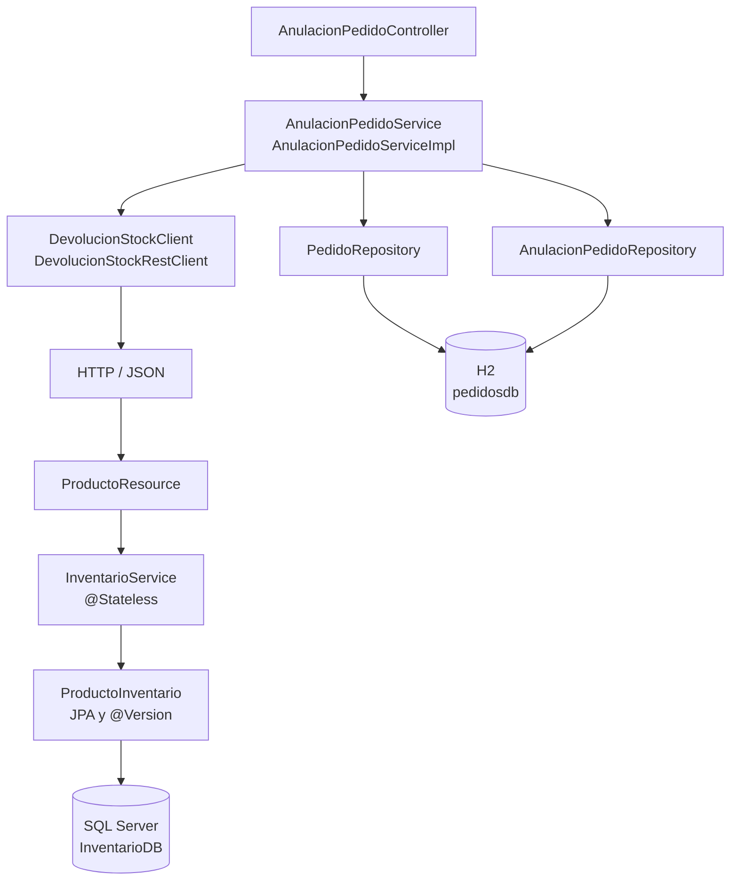

# Arquitectura de anulaciones PA2

El Controller recibe y devuelve DTO. El Service recibe sus tres
dependencias mediante constructor y coordina la operación.

La devolución se solicita por HTTP a Inventario. Después de confirmar
la devolución, el Service actualiza el pedido y guarda la anulación
en H2.

@Transactional controla únicamente los cambios locales en H2.
Inventario administra su propia transacción en SQL Server.
No existe una transacción distribuida entre ambas aplicaciones.